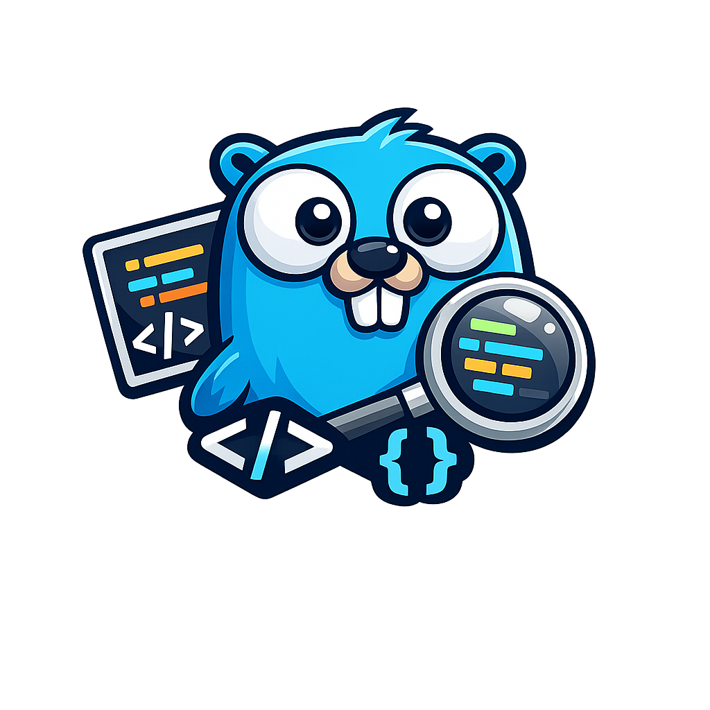

<p align="center">
  
</p>

<h1 align="center">Go Code Visualizer</h1>

<p align="center">
  Пошаговая визуализация Go-кода · Wails · Delve · React
</p>

<p align="center">
  <a href="https://github.com/saltlakecity/code-visualiser/releases">Скачать релиз</a>
  ·
  <a href="#build-from-source">Сборка из исходников</a>
</p>

---

Desktop-приложение для пошагового разбора Go-кода: отладка через Delve, переменные, timeline и визуализация структур данных.

## Download

Готовые сборки публикуются на **[GitHub Releases](https://github.com/saltlakecity/code-visualiser/releases)**.

| Файл | Назначение |
|------|------------|
| `visualisator-amd64-installer.exe` | Установщик Windows (рекомендуется) |
| `visualisator.exe` | Portable-версия без установки |
| `visualisator-portable.zip` | Архив с portable exe |

## Install (Windows)

### Требования

- **Windows 10** или новее (64-bit)
- **[Go 1.22+](https://go.dev/dl/)** — `go` должен быть в `PATH` (нужен для компиляции пользовательского кода)
- **WebView2 Runtime** — установщик ставит его автоматически, если ещё нет

> Delve встроен в приложение. Отдельный `dlv` на PATH не требуется.

### Установка

1. Скачайте `visualisator-amd64-installer.exe` из [Releases](https://github.com/saltlakecity/code-visualiser/releases).
2. Запустите установщик и следуйте мастеру.
3. Запустите **Go Code Visualizer** из меню Пуск или с рабочего стола.

### Данные после установки

При установке в `Program Files` приложение сохраняет данные в:

```
%AppData%\visualisator\
  settings.json
  custom\
  sessions\
  webview2\
  app.log
```

## Portable mode

Скачайте `visualisator.exe` или распакуйте `visualisator-portable.zip` в любую папку и запустите. Данные создаются рядом с exe:

```
visualisator.exe
data/
  settings.json
  custom/
  sessions/
  app.log
```

## Usage

1. Выберите задачу или **Custom Code**
2. Нажмите **Run** — компиляция и debug trace
3. Шагайте по коду: timeline, переменные, call stack, визуализация (графы, массивы, стек)

Редактор кода — Monaco с подсветкой Go.

## Build from source

### Requirements

- Go 1.22+
- [Node.js](https://nodejs.org/) 18+
- [Wails CLI v2](https://wails.io/docs/gettingstarted/installation): `go install github.com/wailsapp/wails/v2/cmd/wails@latest`
- [NSIS](https://nsis.sourceforge.io/Download) — только для сборки установщика (`winget install NSIS.NSIS`)
- [WebView2 Runtime](https://developer.microsoft.com/microsoft-edge/webview2/) (обычно уже есть в Windows 11)

### Dev mode (hot reload)

Из корня репозитория:

```powershell
wails dev
```

### Production build + installer

```powershell
.\scripts\build-installer.ps1
```

Артефакты:

- `build\bin\visualisator.exe` — portable GUI-приложение
- `build\bin\visualisator-amd64-installer.exe` — NSIS-установщик

**Важно:** для desktop-сборки используйте Wails, а не `go build`. Release-бинарник — GUI-приложение (`-H windowsgui` в `wails.json`), консольное окно не должно мелькать.

Ручная сборка без скрипта:

```powershell
wails build -clean -nsis -trimpath
```

### Publish a release

1. Обновите `productVersion` в [`wails.json`](wails.json).
2. Создайте и запушьте тег (версия должна совпадать):

```powershell
git tag v1.0.0
git push origin v1.0.0
```

GitHub Actions соберёт установщик и опубликует [Release](https://github.com/saltlakecity/code-visualiser/releases).

## Troubleshooting

### Log file

- **Portable:** `data\app.log` рядом с exe
- **Installed:** `%AppData%\visualisator\app.log`

### Healthy startup

```
main: start exe=...
lifecycle: dom ready
main: exit ok
```

(`main: exit ok` появляется только после закрытия окна.)

### Window not visible

Если в логе есть `dom ready`, но окна не видно:

1. Проверьте панель задач / **Alt+Tab** — «Go Code Visualizer».
2. Очистите кэш WebView2 (путь зависит от режима):
   - portable: `Remove-Item -Recurse -Force .\data\webview2`
   - installed: `Remove-Item -Recurse -Force "$env:APPDATA\visualisator\webview2"`
3. Пересоберите: `wails build` или `.\scripts\build-installer.ps1`
4. Не используйте `wails build -windowsconsole`, если не нужна консоль для отладки.

### Debug build (DevTools + console)

```powershell
wails build -debug
.\build\bin\visualisator.exe
```

## Application icon

Иконка: [`build/appicon.png`](build/appicon.png). После замены пересоберите приложение. Подробнее: [Wails — generate icons](https://wails.io/docs/guides/application-development/#application-icon).
